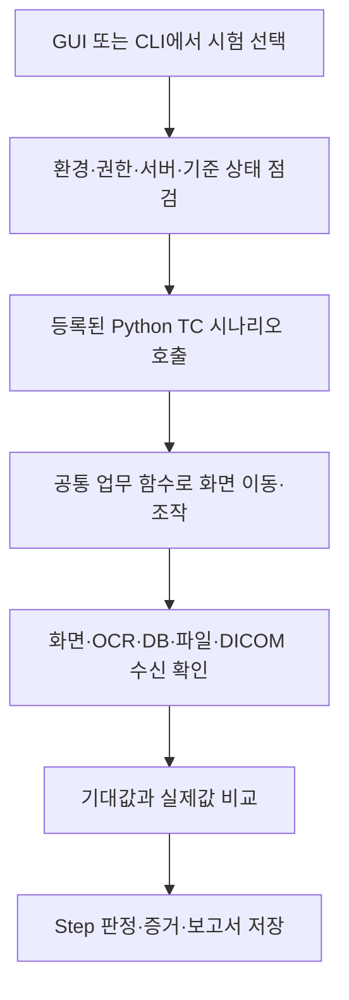

# Bellalun·VXvue 자동화 구현과 워크플로우 — 전파교육 참고자료

QA 담당자와 자동화 유지보수자가 테스트 선택부터 UI 조작, 결과 확인, 보고서 판독까지 설명할 수 있도록 정리한 자료다. 두 제품의 자동화는 **Python 시나리오가 실제 Windows 화면을 조작하고 화면·DB·파일·DICOM 수신 결과를 비교하는 방식**이다.

작성일: 2026-11-11. 구현 설명 기준은 Bellalun `66fa09f`, VXvue `f495cf8`이다. 문서 작성은 소스 검토이며 제품 시험이나 현재 PC의 동작 보증이 아니다. 이후 코드가 바뀌면 교육 전에 해당 진입점과 운영 안내를 다시 확인한다. 제품 사양·TC Expected의 원본을 이 문서로 대체하지 않는다.

## 1. 교육 목표와 진행 순서

| 권장 시간 | 주제 | 교육 후 설명할 수 있어야 하는 것 |
|---|---|---|
| 3분 | 전체 구조와 용어 | 시나리오·UI 드라이버·판정 계층의 역할 |
| 5분 | 화면 접근 방식 | 컨트롤 탐색, 입력, OCR의 차이 |
| 8분 | MWL 시나리오 비교 | 준비 → 화면 이동 → 조작 → 독립된 근거로 확인 |
| 5분 | 개별 실행과 전체 회귀 | 선행조건·순서·감독·재개 처리의 차이 |
| 5분 | 보고서와 장애 분류 | 자동화 FAIL과 제품 결함을 구분하는 방법 |
| 4분 | 코드 읽기 실습·질의 | 실행 없이 한 TC의 호출 경로를 찾아 설명 |

교육 시에는 먼저 2절 흐름도를 보여 주고, 5절의 MWL 예시를 따라간 뒤 실제 파일을 연다. Windows 메시지 상수나 SQL 세부 문법은 동작을 이해하는 데 필요한 만큼만 설명한다.

### 기본 용어

| 용어 | 이 자료에서의 뜻 |
|---|---|
| TC / Step | 체크리스트의 시험 항목 / 그 안의 개별 절차 |
| 시나리오 | 준비·조작·확인·결과 기록을 묶은 Python 함수 |
| UI 드라이버 | 제품 창·버튼·입력란을 찾고 조작하는 공통 코드 |
| MWL | 서버에 등록된 촬영 처방을 뷰어가 조회하는 DICOM Worklist |
| Storage / Print SCP | 전송된 영상 / 프린트 작업을 받는 시험 서버 |
| Baseline | 반복 시험의 시작 상태로 되돌리기 위한 기준 DB·파일 |
| Expected / Actual | 근거에 따라 정한 기대 결과 / 실제 관찰 결과 |

## 2. 전체 구조: 시나리오와 공통 기능을 분리한다



실행 중 AI가 매번 다음 클릭을 결정하는 구조가 아니라, 미리 구현된 절차와 조건을 따라간다. AI의 코드 작성·분석 지원과 실제 시험 엔진의 동작을 구분해 설명한다.

| 책임 | Bellalun | VXvue |
|---|---|---|
| 명령 선택·연결 | `run.py` | `run.py` |
| 개별 시험 절차 | `tests/workflowNN.py`, 기능군별 모듈 | `tests/tcNN_*.py` |
| 반복 업무 동작 | `core/flows.py` | `core/workflow.py` |
| 창과 컨트롤 조작 | `core/ui.py`의 `ViewerUi` | `core/ui.py`의 `VXvueUi` |
| DB·외부 서버 확인 | `core/db.py`, DICOM 관련 모듈 | `core/db.py`, DICOM 관련 모듈 |
| 단계별 결과·보고서 | `core/result.py`의 `TCResult` | `core/result.py`와 보고서 모듈 |
| 전체 시험 실행 관리 | `run.py`의 회귀 체인 | `core/regression.py` |
| 자동화 가능 범위 | `automation_scope.json` | `automation_scope.json` 및 테마별 범위 |

두 프로젝트는 설계 원칙이 비슷하지만 독립된 구현이다. 한 제품의 컨트롤 ID·화면 좌표·TC 번호를 다른 제품에 그대로 적용하지 않는다. `tests/`의 제품 시나리오와 제품을 켜지 않는 자체 단위시험도 구분한다.

**발표자 메모:** 시나리오는 “무엇을 시험하나”, 공통 업무 함수는 “화면에서 그 업무를 어떻게 하나”, UI 드라이버는 “창과 컨트롤을 어떻게 다루나”에 답한다고 설명한다.

## 3. 화면에는 어떻게 접근하는가

두 자동화는 Python `ctypes`를 통해 Windows API를 호출한다. 제품 PID로 대상 창을 좁히고, 창 핸들과 컨트롤 ID·클래스·텍스트를 이용해 필요한 대상을 찾는다.

| 대상 | 접근 방법 | 주의할 점 |
|---|---|---|
| 표준 버튼·입력란 | 컨트롤 탐색, Windows 메시지, 키보드 입력 | 존재·활성 상태와 조작 후 결과를 확인 |
| 텍스트를 직접 읽을 수 있는 컨트롤 | `WM_GETTEXT` 등 | 보이는 화면·현재 대상이 맞는지 확인 |
| 직접 그린 목록·영상 Overlay | 화면 캡처와 Tesseract OCR | 잘림·빈 판독·모호한 인식을 성공으로 처리하지 않음 |
| 좌표가 필요한 UI | 탐색한 창·컨트롤 영역을 기준으로 위치 계산 | 해상도·배율·테마·제품 버전에 따른 영향 확인 |

표준 컨트롤 클릭에 `BM_CLICK`, 텍스트 설정에 `WM_SETTEXT`, 입력 합성에 `SendInput` 등을 사용한다. 모든 조작을 같은 API로 수행하는 것은 아니며 화면 종류에 따라 경로가 다르다.

클릭 호출이 성공했다는 사실은 해당 제품 기능의 완료를 뜻하지 않는다. 예를 들어 Send 클릭 뒤 Queue·수신 서버·DICOM 태그를 확인해야 전송 결과를 설명할 수 있다.

## 4. 시나리오를 선택하면 어떤 코드가 호출되는가

### Bellalun

`run.py`가 명령을 해석하고 `Context`를 준비한다. `Context`는 환경 설정, DB 연결, 증거·보고서 저장 경로 등을 전달한다. `run-wf01`은 `tests/workflow01.py`의 `run(ctx)`로 연결된다.

### VXvue

`tc02` 명령은 공통 실행 함수 `_run_tc_module()`을 거쳐 `tests.tc02_mwl_workflow`를 불러온다. UI·설정·시나리오 인자를 준비한 뒤 모듈의 `run(ui, cfg, ...)`를 실행하고 결과 저장·알림을 처리한다. 전체 회귀의 TC 작업 프로세스 경로는 이 개별 실행 경로와 구분한다.

아래는 구조를 설명하기 위한 의사코드이며 실제 실행 코드가 아니다.

```python
def scenario(context):
    result = create_result(tc_id, title)
    expected = prepare_and_verify_test_data(context)
    open_required_screen(context)
    perform_user_action(context)
    actual = read_ui_and_independent_evidence(context)
    compare_and_record(result, expected, actual)
    return result
```

## 5. 대표 시나리오: MWL 조회부터 결과 확인까지

### Bellalun WF01 — MWL 조회 및 Local 검사 생성

1. MWL 서버 등록값·활성화·연결을 확인한다. 연결되지 않았으면 검색 결과가 없다는 제품 문제로 오판하지 않는다.
2. 시험 처방을 준비하고 환자·처방 정보와 Study UID가 유효한지 확인한다.
3. Viewer를 시작하고 Patient 화면으로 이동한다.
4. 필요한 목록 열과 MWL 검색 대상을 준비하고 시험 환자를 조회한다.
5. 조회 정보와 검사 화면의 정보를 기준값과 비교한다.
6. 검사 종료 후 DB 저장 결과를 확인하고 Local 검사 생성 흐름도 검증한다.

WF01의 목적을 VXvue TC02와 같다고 설명하지 않는다. 촬영·영상 처리 등 별도 Bellalun 시험은 해당 Workflow나 XIPL 시나리오로 이어진다.

### VXvue TC02 — MWL 조회·촬영·DB·전송 확인

1. MWL 처방을 기준 데이터로 삼고 Registration의 Scheduled 목록에서 조회한다.
2. 화면의 환자·처방 정보를 등록값과 비교한다.
3. 촬영 화면으로 이동해 선택된 실행 모드의 촬영 경로를 수행한다.
4. 검사 종료 후 Database와 SQL 조회 결과를 확인한다.
5. 전송을 수행하고 수신된 DICOM 객체의 정보를 비교한다.

| 비교 위치 | 확인하려는 질문 | 기준 |
|---|---|---|
| 목록·촬영 화면 | 처방 정보가 화면에 맞게 표시되는가? | MWL 서버 등록값 |
| 제품 DB | 검사 종료 후 정보가 올바르게 저장됐는가? | 시험 환자·처방값과 저장 규칙 |
| 수신 서버 | 실제로 어떤 객체와 정보가 도착했는가? | 수신 DICOM 태그와 해당 TC Expected |

화면에서 읽은 값을 그대로 정답으로 삼으면 화면 자체의 오류를 검출할 수 없다. 원래 등록한 처방처럼 별도로 확보한 기준이 필요하다. 수신 객체 종류도 확인해야 하며, 서로 다른 SOP Class의 값을 무조건 같은 규칙으로 비교하지 않는다.

**발표자 메모:** “처방은 맞는데 화면만 틀린 경우”, “화면은 맞는데 DB가 틀린 경우”, “보냈다고 표시했지만 수신되지 않은 경우”를 각각 어떤 확인 지점이 잡는지 질문한다.

## 6. 기다림·선행조건·전체 실행 순서

고정 시간 대기도 일부 있지만, 주요 단계는 상태를 반복 확인한다. Bellalun의 `wait_ready`, `wait_instance_types`, `wait_study_closed`와 VXvue의 `wait_acquisition_ready`, `wait_processing_done`이 대표적이다. 제한 시간 내 조건을 만족하지 못하면 실패·중단 근거를 남긴다. timeout만으로 제품 결함을 확정하지 않는다.

| 구분 | 개별 TC | 전체 회귀 |
|---|---|---|
| 시작 상태 | 해당 TC의 선행조건을 별도로 준비해야 함 | 기준 상태 복원·로그인·서버 준비 등을 포함 |
| 실행 순서 | 선택한 TC 중심 | 데이터 의존관계를 고려한 순서 |
| 이전 데이터 | 필요한 시험 환자·영상이 없으면 준비 실패 가능 | 앞 TC가 만든 영상을 뒤 TC가 재사용할 수 있음 |
| 결과 의미 | 실행한 TC·조건에 한정 | 실행된 전체 범위와 미수행 범위를 함께 기록 |

Bellalun은 기본기능 회귀와 실시간 WU 체인이 별도 진입점이다. WU 체인에는 단계별 저장점·재개 처리가 있다. 준비 게이트가 실패하면 의미 없는 후속 시험을 계속하지 않도록 처리한다.

VXvue는 WU 체크리스트 중심으로 전체 회귀를 구성한다. TC05·TC07은 앞 시험의 스터디를 재사용하며, 사람 확인이 포함된 TC12는 마지막에 실행한다. 실제 실행 순서와 보고서의 번호순 정렬은 다를 수 있다.

확인한 VXvue 구현에서 일반 전체 회귀 경로는 TC 작업 프로세스를 감독 프로세스가 관리한다. 시간 초과·결과 형식 오류 등에 대한 진단을 남긴다. 모든 단독 실행이나 모든 옵션이 같은 프로세스 경로를 쓰는 것은 아니다. Bellalun과 VXvue의 감독·복구 기능을 동일한 구현이라고 설명하지 않는다.

## 7. 실행 방법: 설명용 명령과 실제 실습을 구분한다

일반 QA 사용자는 설치된 프로그램의 GUI에서 실행 범위와 준비 상태를 확인하고 동의한 뒤 시작한다. 개발자는 아래 소스 명령으로 개별 진입점을 찾을 수 있다. 각 저장소의 `auto/`에서 실행하는 명령 예시이며 **교육 중 자동 실행할 명령 목록이 아니다.**

| 목적 | Bellalun | VXvue |
|---|---|---|
| 도움말 확인 | `python run.py --help` | `python run.py --help` |
| 개별 MWL 시험 | `python run.py run-wf01` | `python run.py tc02` |
| 영상 처리 시험 예시 | `python run.py run-xipl-03` | `python run.py tc04` |
| 전체 회귀 | `python run.py run-regression` | `python run.py run-regression` |
| 별도 실시간 WU 체인 | `python run.py run-winupdate` | WU 중심 전체 회귀 사용 |

관리자 권한·제품 버전·해상도/배율·라이선스·서버·시험 데이터 등은 제품별 운영 안내를 따른다. 전체 회귀는 DB·데이터를 기준 상태로 복원할 수 있다. UI 입력은 PC를 점유하며 USB·촬영·설정 변경이 수반될 수 있으므로 실제 교육 시연은 대상 빌드·범위·시간·변경 범위를 정하고 승인을 받은 뒤 수행한다. 데모와 실제 촬영 경로를 임의로 바꾸지 않는다.

## 8. 결과를 읽고 제품 결함 여부를 판단하는 방법

`TCResult`에는 단계별 기대값·실제값·판정·설명·증거가 모인다. 보고서는 이 결과를 HTML·JSON 등으로 저장한다. 사람 검수는 자동 판정과 별개이며, 수행하지 못한 부분을 PASS로 바꾸지 않는다.

`PASS`는 확인한 기준 충족, `FAIL`은 해당 확인의 실패다. `MANUAL`은 사람 확인이 남은 항목이고 `SKIP`은 수행하지 않은 항목이다. 각 결과의 설명과 실제 수행 범위를 함께 읽으며 자동화 수준(FULL/PARTIAL 등)을 실행 결과와 혼동하지 않는다.

| 결과·사건 | 확인할 자료 | 바로 단정하면 안 되는 것 |
|---|---|---|
| OCR 판독 실패 | 원본 캡처·대상 영역·판독 기록 | 화면 값 자체가 틀렸다는 주장 |
| 서버 연결 실패 | 등록 설정·접속·Echo·서버 상태 | 제품의 조회·전송 기능 결함 |
| TC 작업 시간 초과 | 마지막 단계·스택·UI·프로세스·로그 | 제품이 멈췄다는 주장 |
| 제품 프로세스 종료 | Windows 이벤트·제품 로그·자동화 종료 동작 | 사용자 강제 종료 또는 제품 충돌 원인의 확정 |
| 파일 누락 | 같은 버전의 원본 ZIP·구성 문서·실행 조건 | 특정 UI 기능이 고장 났다는 주장 |
| 후속 시험 통과 | 후속 실행 버전·조건·증거 | 과거 충돌의 원인이 수정됐다는 주장 |

보고서는 실행 버전과 환경 → 전체 결론 → 실패한 TC·Step → Expected/Actual → 캡처·DB·서버·로그 → 미수행·수동 항목 순으로 읽는다. 알려진 제품 결함 허용 여부와 자동화가 기록한 원래 FAIL도 구분한다.

예를 들어 Export Manager 종료 조사에는 Windows 충돌 이벤트를 인용한 기록이 있으나, 현재 PC에서 그 이벤트 원본을 다시 확인했는지와 현재 재현 여부는 별도 질문이다. 관련 재검증은 [잔여작업](../NEXT_WORK.md)에 있다. 이 교육자료는 세 결함 후보의 판정을 확정하지 않는다.

## 9. 제품을 조작하지 않는 교육 실습

1. Bellalun `run.py`에서 `run-wf01`을 검색하고 `workflow01.run(ctx)` 연결을 찾는다.
2. WF01에서 준비·화면 조작·DB 비교·결과 기록 구간을 표시한다.
3. VXvue `cmd_tc02` → `_run_tc_module` → `tests.tc02_mwl_workflow.run`을 따라간다.
4. 각 시나리오에서 정답 데이터의 출처와 완료 대기 조건을 찾아 설명한다.
5. 승인된 비식별 보고서에서 실패 Step 하나를 골라 제품·환경·자동화 중 어떤 추가 증거가 필요한지 적는다.

확인 질문: “버튼을 눌렀으니 PASS인가?”, “단독 TC 실행 전 필요한 데이터가 무엇인가?”, “timeout과 충돌은 같은가?”, “사람 확인 항목을 자동 PASS로 바꿔도 되는가?” 각 답변에 실제 코드나 증거를 연결한다.

## 10. 코드 근거와 REA 조사 범위

Bellalun 근거는 [실행 진입점](../run.py), [WF01](../tests/workflow01.py), [UI 드라이버](../core/ui.py), [업무 흐름](../core/flows.py), [결과 기록](../core/result.py), [구조 안내](architecture.md)에 있다. 실제 운영과 승인 절차는 [검증 안내](testing-guide.md)를 따른다.

VXvue는 다른 저장소이므로 확인한 커밋으로 고정해 연결한다.

- [명령·개별 TC 실행](https://github.com/hongmin3/vxvue-automation/blob/f495cf8fd26d83f2b34f1d99cf39d58a8c2e40dc/run.py)
- [TC02 MWL 시나리오](https://github.com/hongmin3/vxvue-automation/blob/f495cf8fd26d83f2b34f1d99cf39d58a8c2e40dc/tests/tc02_mwl_workflow.py)
- [전체 회귀·순서·작업 프로세스 연결](https://github.com/hongmin3/vxvue-automation/blob/f495cf8fd26d83f2b34f1d99cf39d58a8c2e40dc/core/regression.py)
- [UI 드라이버](https://github.com/hongmin3/vxvue-automation/blob/f495cf8fd26d83f2b34f1d99cf39d58a8c2e40dc/core/ui.py)
- [TC 작업 프로세스](https://github.com/hongmin3/vxvue-automation/blob/f495cf8fd26d83f2b34f1d99cf39d58a8c2e40dc/core/tc_worker.py)와 [감독 프로세스](https://github.com/hongmin3/vxvue-automation/blob/f495cf8fd26d83f2b34f1d99cf39d58a8c2e40dc/core/worker_supervisor.py)

REA 스킬과 `inspect_python_pyc` 도구로 기존 Bellalun WF01의 Python 3.12 캐시를 실행 없이 검사했다. 코드 객체 16개와 `run`에서 참조한 UI·DB·대기 함수 이름을 확인한 보조 자료다. 증거 ID는 `ev_4442a54248f42268acd5369c23e60e8b22004be5ddfbc54735ab8471c8d17b3b`이다.

이 REA 결과는 역컴파일·실제 실행·현재 설치 EXE 검증이 아니며 캐시와 최신 소스의 일치도 보장하지 않는다. 따라서 구현 설명은 확인한 소스를 기준으로 작성했다. 증거 ID만으로 재조회가 가능하다고 가정하지 않으며, 교육에 필요한 호출 경로는 위 코드에서 확인한다.
